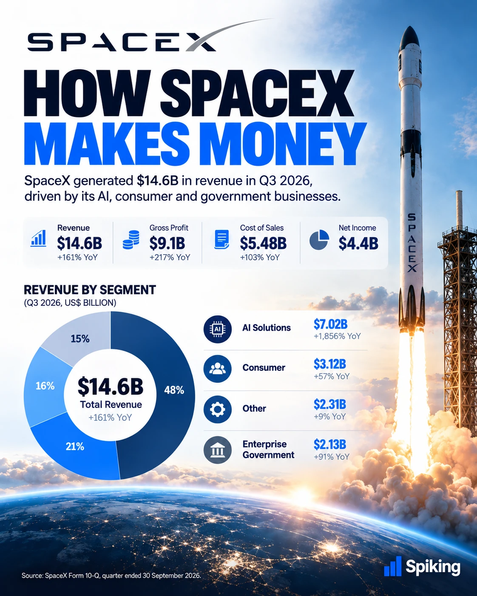
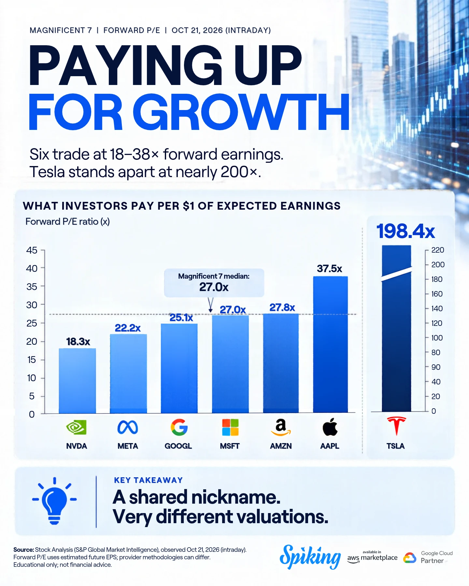
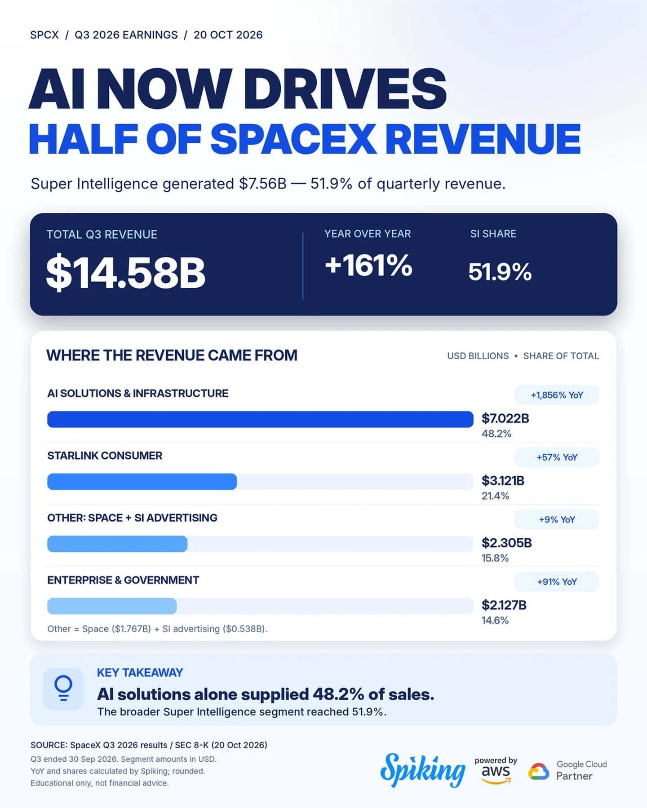

# Spiking infographic workflow


No secrets are stored in this repo. Tokens live in `.env` / environment variables only.

## How it works

```
Schedule (daily 9:00)  →  Claude reads claude/SKILL.md
                          │
                          ├─ python3 fetch.py   (get new Instagram posts)
                          ├─ Claude picks the best post and writes brief.md
                          ├─ Brief is saved to Google Drive
                          └─ ChatGPT reads the brief from Drive and makes the infographic
```

## Example results

Infographics produced with this workflow (files in `chatgpt/output-examples/`):

<table>
  <tr>
    <td></td>
    <td></td>
    <td></td>
  </tr>
  <tr>
    <td></td>
    <td></td>
    <td></td>
  </tr>
</table>

---

## How to restore / reuse (read this first)

Personal details were replaced with placeholders before publishing. Fill them in on your own machine; keep the real values in a private place (password manager / private note), NOT in this repo.

| Placeholder | Where it appears | What to put |
|---|---|---|
| `EXAMPLE_ACCOUNT_NAME_HERE` | `code/fetch.py` (`DEFAULT_ACCOUNTS`), `code/.env.example` (`ACCOUNTS=`) | Instagram usernames to monitor, comma-separated, no `@`. Must be public Business/Creator accounts. Easiest: set `ACCOUNTS=` in `.env` and leave the code alone. |
| `<PROJECT_DIR>` | `claude/SKILL.md` step 1 | Folder where you put `fetch.py` (e.g. `~/Desktop/fetch-infographic`) |
| `<DRIVE_FOLDER>` | `claude/SKILL.md` step 3 | Folder that holds `style-guide.md` and the dated result folders (the Google Drive folder ChatGPT reads) |

### Restore on a Mac
1. Copy `code/` to a folder (e.g. `~/Desktop/fetch-infographic`). Put `claude/daily-brief.md` in `<that folder>/.claude/commands/` to get the `/daily-brief` command.
2. Copy `.env.example` to `.env`, then `chmod 600 .env`, and fill in:
   - `IG_USER_ID`: the Instagram Business account ID linked to your Facebook Page.
   - `IG_TOKEN`: a Meta **Page** access token (type PAGE, never expires). Get it in Graph API Explorer: call `me/accounts` with your user token and copy the Page's `access_token`.
   - `OUT_DIR`: where dated result folders are written (e.g. a synced Google Drive folder).
   - `ACCOUNTS`: the Instagram usernames to monitor.
   - Optional Drive upload: `GOOGLE_CLIENT_ID`, `GOOGLE_CLIENT_SECRET` (OAuth client type Desktop app), then run `python3 get_google_token.py` once to get `GOOGLE_REFRESH_TOKEN`.
3. Test: `python3 fetch.py` (prints the dated output folder). If Python reports certificate errors, run "Install Certificates.command" for your Python version once.
4. Recreate the daily schedule: in Claude desktop create a scheduled task (9:00) and paste the body of `claude/SKILL.md` as the prompt, with `<PROJECT_DIR>` and `<DRIVE_FOLDER>` replaced by your real paths.
5. ChatGPT: put `chatgpt/style-guide.md` (and your sample images + official logo PNG) in the Drive folder it reads.

### Run on Claude cloud (optional)
Put `fetch.py` (and `gdrive.py` if uploading to Drive) in the environment's Setup script, set `IG_TOKEN`, `IG_USER_ID`, `ACCOUNTS`, `OUT_DIR` (+ `GOOGLE_*`) as environment variables, allow network domains `graph.facebook.com`, `*.cdninstagram.com`, `*.fbcdn.net` (+ `www.googleapis.com`, `oauth2.googleapis.com` for Drive), and paste the `claude/SKILL.md` body into the Routine's Instructions. Note: environment variables are visible to everyone using that environment.

### Notes
- `fetch.py` defaults: last 3 days, best 2 posts per account, ranked by engagement rate; `--days`, `--per-account`, `--top`, `--upload`, `--keep-hours` override. It also deletes dated result folders older than 24h in `OUT_DIR`.
- Token problems: if Meta calls fail, get a fresh Page token as above and update `IG_TOKEN`.
