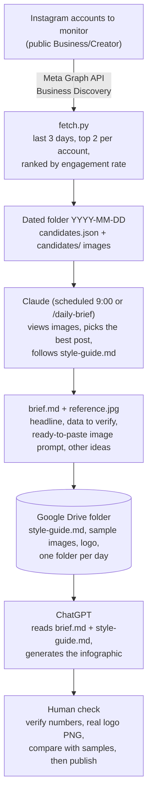

# Spiking infographic workflow (backup)

- `code/`: scripts (`fetch.py` lists/ranks recent Instagram posts via Meta Business Discovery; `gdrive.py` + `get_google_token.py` optional Drive upload). Copy `.env.example` to `.env` and fill in your own values. NEVER commit `.env`.
- `claude/`: the Claude prompts. `SKILL.md` = the scheduled-task instructions (paths are for the original Mac; adapt for cloud), `daily-brief.md` = the `/daily-brief` slash command (goes in `.claude/commands/`).
- `chatgpt/`: files meant for ChatGPT (style guide etc.).

No secrets are stored in this repo. Tokens live in `.env` / environment variables only.

## How it works

Every morning Claude finds the best recent viral post, turns it into a brief, saves it to Google Drive, and ChatGPT reads that brief from Drive to generate the infographic.

**Steps in plain words**
1. **Collect (`fetch.py`)**: calls the Meta Graph API for each monitored account, keeps posts from the last 3 days, takes the best 2 per account by engagement rate (likes + comments divided by followers), and saves them with their images in a folder named by date.
2. **Decide (Claude)**: looks at the candidate images, skips personal or non-data posts, prefers US-stock topics shown as simple lists or charts, picks one, and never reuses a post already chosen that day. It uses the post only as inspiration, not as content to copy.
3. **Brief (Claude)**: writes `brief.md` (why it was chosen, which numbers must be verified from primary sources, a catchy two-line headline, chart type, and an image-generation prompt following `style-guide.md`) plus `reference.jpg`, and lists a few other trending topics.
4. **Store (Google Drive)**: the dated folder lives in one Drive folder together with `style-guide.md`, the sample images and the official logo. On a Mac the Drive desktop app syncs it automatically; on Claude cloud `gdrive.py` uploads it through the Drive API.
5. **Generate (ChatGPT)**: reads `brief.md` and the style guide from Drive and creates the image.
6. **Review (human)**: verify every number against its source, use the real logo file, compare with the sample posts, then publish.

**Who runs where**

| Part | Runs on | Triggered by |
|---|---|---|
| `fetch.py`, brief writing | Claude (Mac scheduled task, or Claude cloud Routine) | Daily 9:00, or `/daily-brief` by hand |
| Storage | Google Drive | Drive desktop sync, or `gdrive.py` |
| Image generation | ChatGPT | A person (or a ChatGPT automation) reading the Drive folder |

Old dated folders are deleted automatically after 24 hours so the Drive folder stays small.

---

## How to restore / reuse (read this first)

Personal details were replaced with placeholders before publishing. Fill them in on your own machine; keep the real values in a private place (password manager / private note), NOT in this repo.

| Placeholder | Where it appears | What to put |
|---|---|---|
| `EXAMPLE_ACCOUNT_NAME_HERE` | `code/fetch.py` (`DEFAULT_ACCOUNTS`), `code/.env.example` (`ACCOUNTS=`) | Instagram usernames to monitor, comma-separated, no `@`. Must be public Business/Creator accounts. Easiest: set `ACCOUNTS=` in `.env` and leave the code alone. |
| `<PROJECT_DIR>` | `claude/SKILL.md` step 1 | Folder where you put `fetch.py` (e.g. `~/Desktop/fetch-infographic`) |
| `<DRIVE_FOLDER>` | `claude/SKILL.md` step 3 | Folder that holds `style-guide.md` and the dated result folders (the Google Drive folder ChatGPT reads) |

### Restore on a Mac
1. Copy `code/` to a folder (e.g. `~/Desktop/fetch-infographic`). Put `claude/daily-brief.md` in `<that folder>/.claude/commands/` to get the `/daily-brief` command.
2. Copy `.env.example` to `.env`, then `chmod 600 .env`, and fill in:
   - `IG_USER_ID`: the Instagram Business account ID linked to your Facebook Page.
   - `IG_TOKEN`: a Meta **Page** access token (type PAGE, never expires). Get it in Graph API Explorer: call `me/accounts` with your user token and copy the Page's `access_token`.
   - `OUT_DIR`: where dated result folders are written (e.g. a synced Google Drive folder).
   - `ACCOUNTS`: the Instagram usernames to monitor.
   - Optional Drive upload: `GOOGLE_CLIENT_ID`, `GOOGLE_CLIENT_SECRET` (OAuth client type Desktop app), then run `python3 get_google_token.py` once to get `GOOGLE_REFRESH_TOKEN`.
3. Test: `python3 fetch.py` (prints the dated output folder). If Python reports certificate errors, run "Install Certificates.command" for your Python version once.
4. Recreate the daily schedule: in Claude desktop create a scheduled task (9:00) and paste the body of `claude/SKILL.md` as the prompt, with `<PROJECT_DIR>` and `<DRIVE_FOLDER>` replaced by your real paths.
5. ChatGPT: put `chatgpt/style-guide.md` (and your sample images + official logo PNG) in the Drive folder it reads.

### Run on Claude cloud (optional)
Put `fetch.py` (and `gdrive.py` if uploading to Drive) in the environment's Setup script, set `IG_TOKEN`, `IG_USER_ID`, `ACCOUNTS`, `OUT_DIR` (+ `GOOGLE_*`) as environment variables, allow network domains `graph.facebook.com`, `*.cdninstagram.com`, `*.fbcdn.net` (+ `www.googleapis.com`, `oauth2.googleapis.com` for Drive), and paste the `claude/SKILL.md` body into the Routine's Instructions. Note: environment variables are visible to everyone using that environment.

### Notes
- `fetch.py` defaults: last 3 days, best 2 posts per account, ranked by engagement rate; `--days`, `--per-account`, `--top`, `--upload`, `--keep-hours` override. It also deletes dated result folders older than 24h in `OUT_DIR`.
- Token problems: if Meta calls fail, get a fresh Page token as above and update `IG_TOKEN`.
